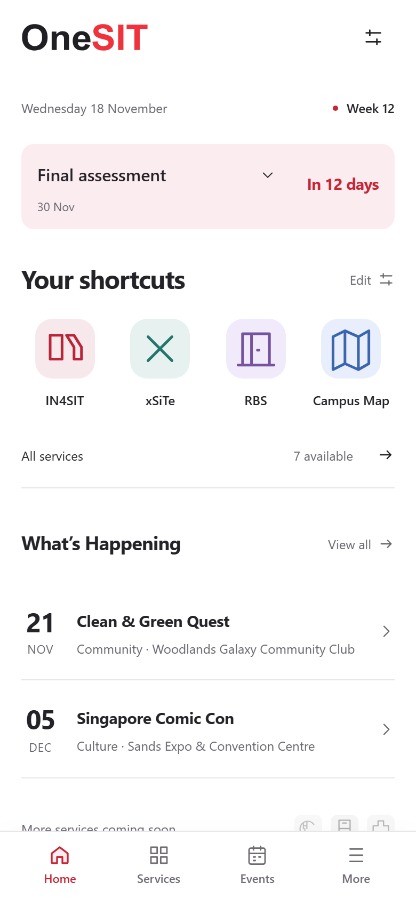
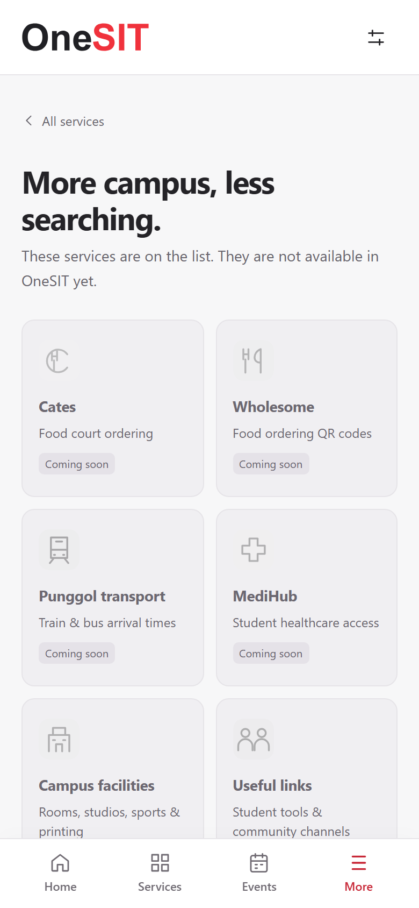

<div align="center">


# OneSIT

### Your campus. One place.

Campus services, academic dates and student events, made for your phone.

[](https://github.com/holsoma/onesit/actions/workflows/checks.yml)
[](https://onesit.vercel.app)
[](LICENSE)
[](docs/ARCHITECTURE.md)

[Open OneSIT](https://onesit.vercel.app) · [Features](#features) · [Setup guide](docs/SETUP.md) · [Contribute](CONTRIBUTING.md) · [Report an issue](https://github.com/holsoma/onesit/issues)

**Not affiliated with SIT.**

</div>

<div align="center">


</div>

## Features

- **Keep your services close.** Open IN4SIT, xSiTe, RBS, Campus Map, the Student Intranet, the academic calendar and ReadyTalent. Star the links you use most.
- **Know your academic week.** A compact week label and one selectable countdown follow the published SIT calendar. Choose Final assessment, Trimester break or Recess week; the choice stays in this browser. Set your own dates when your schedule differs.
- **See What’s Happening.** Browse reviewed event summaries, dates, locations and public organiser links.
- **Use it without an account.** Favourites and personal dates stay in this browser. School services handle their own sign-in.
- **See what is next.** Future services remain in the catalogue with grey icons and clear Coming soon labels.

## Coming soon

Food ordering with Cates and Wholesome, Punggol train and bus times, MediHub, campus facilities, room-code mappings, games inventories, student tools and community links. Android packaging follows the website release.

## Get started

**[Open OneSIT in your browser](https://onesit.vercel.app).** No account is required.

Use Node.js 22.12 or later:

```sh
npm ci
npm run dev
```

Open the local URL printed by Vite. No credentials or environment variables are required for local use.

<details>
<summary><strong>Production build and checks</strong></summary>

```sh
npm run check
node scripts/serve.mjs
```

The production preview runs at `http://127.0.0.1:4400`. Automated browser tests run with `npx playwright test` after `npx playwright install chromium`.

</details>

## Documentation

| Guide                                         | Contents                                                                  |
| --------------------------------------------- | ------------------------------------------------------------------------- |
| [Setup and deployment](docs/SETUP.md)         | Local development, production builds, Vercel and later Android packaging. |
| [Architecture](docs/ARCHITECTURE.md)          | Static pages, local preferences, data, dates and performance.             |
| [Newsletter maintenance](docs/NEWSLETTERS.md) | Local .msg review, public summaries and publication.                      |
| [Brand](docs/BRAND.md)                        | Wordmark concepts, affiliation wording and Vanguard credit.               |
| [Design system](DESIGN.md)                    | Mobile layout, typography, colour and interaction rules.                  |
| [Release validation](docs/VALIDATION.md)      | Browser checks, measured performance and review findings.                  |
| [Contributing](CONTRIBUTING.md)               | Development checks, issue reports and pull requests.                      |

## From a member of SIT Vanguard

OneSIT is an open-source, student-led app piloted by a member of SIT Vanguard. Its wordmark pays homage to SIT Vanguard.

## Built with

[Preact](https://preactjs.com/), [Vite](https://vite.dev/) and TypeScript. Static HTML is generated at build time. The separate newsletter tool uses [MSGReader](https://github.com/HiraokaHyperTools/msgreader) locally in a browser worker.

## Licence and credits

Application code and original assets use the [MIT licence](LICENSE). Service icons are original category illustrations, not official service logos. The OneSIT wordmark takes visual reference from SIT Vanguard; it is not the Vanguard logo. School names, third-party material and event information retain their respective rights. The repository does not include the original newsletter or its posters.
